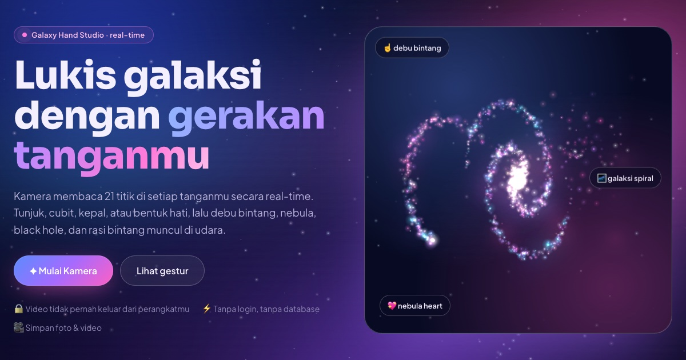

# ✦ Nebula Aurora Sign: Galaxy Hand Studio

_by [Wani Syafitri](https://wanisya.github.io/nebula-aurora-sign/kenalan.html)_

**✦ Coba langsung: https://wanisya.github.io/nebula-aurora-sign/**



Lukis galaksi, rasi bintang, dan nebula heart dengan gerakan tangan di depan kamera. Semua berjalan langsung di browser.

## Menjalankan di komputer sendiri

```bash
cd /Users/mac/mediapipehand
npm start
```

Lalu buka **http://localhost:0120** (port 120, sengaja beda dari web karir di :3000) di Chrome, klik **Mulai Kamera**, dan izinkan akses kamera.

> Kamera browser hanya bisa diakses dari `localhost` atau `https://`. Karena itu file-nya disajikan lewat `server.js`, bukan dibuka dengan klik dua kali.
> Butuh internet saat pertama kali dibuka, karena model MediaPipe dan font diunduh dari CDN.

## Fitur

| Mode | Gestur | Efek |
|---|---|---|
| 🌌 Galaksi | ☝️ Tunjuk | Melukis debu bintang yang menetap |
| | 🤏 Cubit | Memunculkan galaksi spiral yang berputar |
| | 🖐️ Buka | Awan nebula keluar dari telapak |
| | ✊ Kepal → lepas | Black hole menyedot semuanya, lalu BIG BANG dan lahir galaksi baru |
| ✨ Rasi Bintang | ☝️ Tahan diam / 🤏 Cubit | Menaruh bintang |
| | ✊ Kepal | Menyalakan bintang dan menyambungkannya jadi rasi |
| | 🖐️ Buka | Make a wish: hujan bintang jatuh |
| 💖 Nebula Heart | 🫶 Hati dua tangan | Nebula Heart raksasa yang berdetak & mengikuti tangan |
| | 🤏 Cubit | Hati nebula kecil yang melayang |
| | ✊ Kepal | Memecahkan semua hati jadi kelopak cahaya |
| Semua | ✌️ Peace | Ganti palet warna (Aurora Pink, Deep Galaxy, Cosmic Rose, Emerald Aurora) |

Fitur lain: 3 tampilan (Redup / Kamera / Angkasa), foto PNG, rekam video, galeri sesi, layar penuh, dan kontrol mouse sebagai cadangan.

**Shortcut:** `1` `2` `3` mode · `P` foto · `R` rekam · `C` hapus · `V` tampilan · `K` palet · `H` kerangka tangan · `G` panduan · `F` layar penuh · `B` hati besar · `L` nyalakan rasi · `W` wish

## Struktur

```
server.js              server statis Node (tanpa dependensi) + /api/health
public/
  index.html           landing page + studio
  kenalan.html         halaman profil pengembang
  css/style.css        tema galaksi biru × aurora pink
  js/app.js            alur kamera, loop utama, UI, foto/video, galeri
  js/hand-tracker.js   MediaPipe Hand Landmarker (GPU, fallback CPU)
  js/gestures.js       pengenal gestur + deteksi hati dua tangan
  js/effects.js        mesin partikel: galaksi, black hole, heart, rasi, meteor
  js/background.js     animasi langit & demo di landing page
  js/about.js          animasi halaman profil
  js/palettes.js       palet warna, sprite cahaya, utilitas
```

## Tanpa login & database?

Benar, tidak perlu. Deteksi tangan dan efeknya diproses 100% di perangkat pengguna, jadi video tidak pernah dikirim ke server. Foto dan video disimpan sementara di memori tab (galeri sesi), lalu bisa diunduh. Kalau nanti ingin galeri online atau berbagi link, barulah perlu storage atau database.

## Deploy

Web ini di-host gratis di **GitHub Pages**. Setiap push ke branch `main` otomatis mempublikasikan ulang folder `public/` lewat workflow `.github/workflows/pages.yml`. Karena memakai HTTPS, kamera tetap bisa dipakai.

## Ganti port

Default-nya `http://localhost:0120`. Kalau port itu bentrok, jalankan dengan port lain, misalnya `PORT=1200 npm start`.
